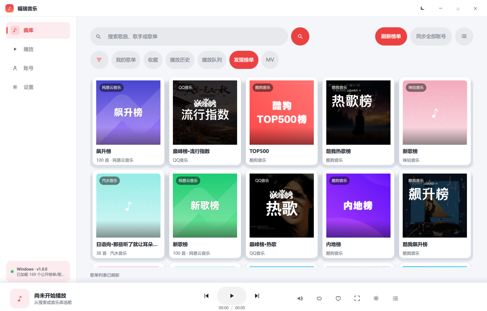
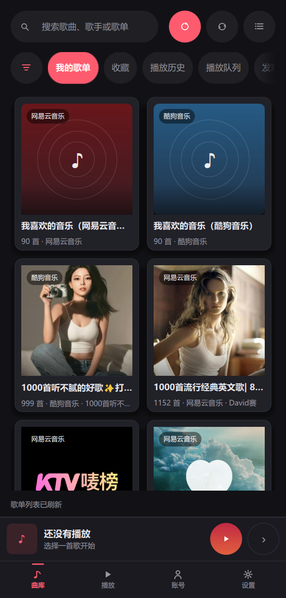

# 福瑞音乐（FuruiMusic）

一套用 Qt + QML 写的跨端音乐播放器：桌面（Windows / Linux / macOS）与移动端（Android）**共用同一套 QML 界面与 C++ 后端逻辑**，界面按窗口宽度自动在桌面宽屏外壳与移动窄屏外壳之间切换。





## 项目定位

- 界面全部是 QML（`src/ui/qml/`），窗口无边框、主题可切换，不使用 WebView 做 UI。
- 平台音源、自定义音源、在线 JS 音源都实现同一套 `MusicSource` 契约，聚合搜索与播放链路不区分来源。
- 没有官方 API 的平台不做假装支持：登录方式、账号接口状态、失败原因都会在界面上如实展示。

## 已实现能力

| 能力 | 说明 |
|---|---|
| 多平台音源聚合 | 网易云、QQ、酷狗、酷我、咪咕、汽水音乐；支持歌曲/歌单/专辑/歌手搜索、榜单、歌单详情、歌词 |
| 登录与歌单同步 | 网易云（密码 / 扫码）、QQ（扫码）、酷狗（扫码）、咪咕（扫码 / 密码）、酷我（帐号密码 / 手机短信 / 微信扫码）为内置直连；汽水需配置自建账号 API 服务后登录并同步歌单 |
| 跨源替代播放 | 内置源取链失败时，自动尝试自定义音源与在线音源，并在界面标注“替代播放” |
| 自定义音源 | 可添加 HTTP 音源（自定义搜索/取链契约）与本地音乐目录 |
| 在线 JS 音源 | 支持导入洛雪（LX Music）风格的在线脚本 URL；内嵌 QuickJS 2024-01-13 执行，脚本能力、版本、检查状态、失败原因分类（syntax/runtime/timeout/network/tls/http/empty）全部可查；支持启用/禁用/更新/删除与持久化 |
| 播放器 | 播放/暂停、上一首/下一首、进度拖动、音量、顺序/列表循环/单曲循环/随机、播放队列；沉浸式播放页与底部播放栏的版式参照 AlgerMusicPlayer（见下） |
| 曲库 | 收藏、播放历史、搜索历史、下载、按平台筛选歌单/收藏/历史；**发现榜单**页并发拉取各平台公开榜单（网易 `/api/toplist`、酷我 `wapi.kuwo.cn/api/www/bang`），未登录也能浏览榜单与曲目，参考 AlgerMusicPlayer 的 toplist / personalized 组织方式 |
| MV 播放 | 曲库内「MV」Tab（全部/内地/港台/欧美/日本/韩国，16:9 封面网格 + 播放量角标 + 滚动续页），点封面进沉浸式播放器：进度拖动、音量/静音、单曲循环、全屏、上一个/下一个、单击暂停、双击 ±10s、控制条自动隐藏。视频解码：Qt 6 用 QtMultimedia 官方 FFmpeg 后端；Qt 5 用自编译 FFmpeg（`FfmpegVideoPlayer`），未编译该后端时才退回 DirectShow 并如实提示 |
| 主题与窗口 | 深色 / 浅色 / 跟随系统（Windows 注册表、macOS `defaults`、Linux `gsettings`，Android 回退浅色）；无边框窗口 + 自绘标题栏 + 边缘缩放 |
| 在线检测更新 | 设置页「检查更新」+ 启动延迟自动检查（参照洛雪音乐 `publish/version.json` 机制，多镜像容错）；有新版本时弹层展示更新说明，用户同意后**应用内直接下载**对应平台的 GitHub Release 产物（不跳转网页），Android 下载完成经 FileProvider 自动拉起系统安装器，桌面端打开安装包所在文件夹 |
| 本地 OpenAPI | 可选的本地 HTTP 服务开关，便于外部控制播放 |
| 手机适配 | 窄屏布局（`MainMobile.qml`）、竖屏截图见 `src/docs/screenshots/` |

## 播放界面（参照 AlgerMusicPlayer）

播放页与底部播放栏按 [AlgerMusicPlayer](https://github.com/algerkong/AlgerMusicPlayer) 的版式重做（账号聚合页仍是本工程自己的设计）：

- **背景就是专辑**：整页是当前封面重度模糊（`FastBlur` radius 96）后的颜色，浅色主题刷白纱、深色主题刷黑纱。浅色皮肤下整页是封面的淡彩，不再出现「白底怼着一张唱片」的突兀对比；切歌时新旧封面交叉淡入。
- **播放页**：左侧一列（封面 → 标题/艺人 → 进度 → 收藏/上一首/播放/下一首/模式 → 音量）整体竖向居中，封面与进度条等宽；右侧歌词左对齐、当前行加粗放大，上下用遮罩渐隐（对应参考项目的 `mask-image`）。左上角是收起按钮，右上角是队列与设置。
- **底部播放栏**：圆角封面 + 曲名/艺人，中间是「上一首 / 胶囊播放键 / 下一首」（胶囊 78×46、浅灰底深色三角，与参考项目一致），右侧依次为音量（悬停向上弹出竖滑块）、播放模式、收藏、展开播放页、设置、队列；图标悬停变主题色并浮出圆形底。
- 播放页自带全套控件，进入后底部播放栏让位（`visible: pageIndex !== 3`），避免同屏两套进度/音量。
- 只让封面做「弹入」，整页不做 opacity 0→1 的淡入：一旦动画被打断（离屏截图、窗口刚显示）整页会永久停在透明而白屏。

## MV 播放（参照 AlgerMusicPlayer）

MV 按 AlgerMusicPlayer 的 `MvPlayer.vue` + `views/mv/index.vue` 组织：

- **入口**：曲库新增「MV」Tab（主导航仍是曲库 / 播放 / 账号 / 设置 4 项），地区分类 全部 / 内地 / 港台 / 欧美 / 日本 / 韩国，16:9 封面网格 + 播放量角标 + 滚动续页；歌曲行与播放页的「播放 MV」按钮也能直接进。数据用网易云 `/api/mv/all`，取址走 `/api/song/enhance/play/mv/url`，封面统一加 `?param=400y225` 并升 HTTPS（原图实测 1~7 秒，缩略图约 80ms）。
- **播放器**：窗口级全屏覆盖层（桌面左侧导航与底部播放栏、移动端标签栏与迷你条都被盖住），黑底 contain 视频；顶部标题 / 艺人 / 解码后端徽标，底部进度、播放暂停、上下曲、音量静音、单曲循环、全屏；播放中静止 3 秒自动收起控制条；单击暂停、双击左右 ±10s、中间全屏；缓冲、失败、播完都有明确状态与出口。
- **跨 Qt 版本**：Qt 5 的 `MediaPlayer` 用 `volume` / `VideoOutput.source`，Qt 6 改为 `AudioOutput` + `MediaPlayer.videoOutput`（Qt 6 的 `VideoOutput` **没有 `source` 属性**，照搬会报 `Cannot assign to non-existent property "source"` 且黑屏）。因此拆成 `MvMedia5.qml` / `MvMedia5Ffmpeg.qml` / `MvMedia6.qml` 三份媒体原语，页面按 `platform.qtMajor` 与 `platform.ffmpegBackend` 加载，UI 只依赖归一化接口（`playing/busy/ended/position/duration/seekable/failed/open/seekTo/...`）。
- **后端矩阵**：

  | 构建 | 后端 | MP4/H.264 |
  |---|---|---|
  | Qt 6（Windows / Android / Linux / macOS） | QtMultimedia 官方 FFmpeg 插件（`ffmpegmediaplugin.dll` / `libavcodec.so` 等，随 `windeployqt` / `androiddeployqt` 部署） | 直接可放 |
  | Qt 5 + 自编译 FFmpeg（Windows / Linux / macOS） | `FfmpegVideoPlayer`：FFmpeg 解码 + `QQuickPaintedItem` 出画 + `QAudioOutput` 出声，不经过任何 mediaservice 插件 | 直接可放 |
  | Qt 5 且未编译 FFmpeg | DirectShow，缺 MP4 分离器 | 页面如实提示并给「用系统播放器打开」与「重试」 |

  Qt5 后端由 `src/scripts/build_ffmpeg_desktop.sh`（Windows 包装 `build_ffmpeg_desktop.bat`）从**随仓库入库**的 `src/thirdparty/ffmpeg/FFmpeg-n6.1.2` 编译静态库。桌面 Qt 5 的 CMake 构建会在 configure 阶段自动调用该脚本（详见「Qt 5 自编译 FFmpeg 播放后端」），再自动定义 `FURUI_HAVE_FFMPEG` 并链接；qmake 与手工脚本仍使用传统产物目录。检测不到产物就退回 DirectShow，**不影响构建**。这套编译脚本参照 `reference/*_build_script` 的源码布局与增量约定，但组件裁剪按「播放」重做——reference 里的 FFmpeg 是屏幕**编码**用的（禁用 avformat/swresample、只留 h264 编码器），不能直接拿来播 MP4。

## 支持平台与依赖

| 平台 | 状态 | 工具链 |
|---|---|---|
| Windows 10/11 x64 | 已本机实测（Qt 5 / Qt 6 双构建，Qt 5 已实播 MV） | **主交付**：Qt 6.11.1 `mingw_64` + MinGW 13.1 + CMake/Ninja（官方 FFmpeg 插件）；Qt 5.15.2 + MinGW 8.1 qmake 兼容构建（自编译 FFmpeg 静态库） |
| Linux x64 | 构建脚本已提供，**未实机验证** | Qt 6.8.3 `gcc_64` + CMake（`qtmultimedia` 模块） |
| macOS | 构建脚本已提供，**未实机验证** | Qt 6.8.3 `clang_64` + CMake（`qtmultimedia` 模块） |
| Android arm64-v8a | Qt 6 arm64-v8a APK 已在本机编译并签名（Qt 5 打包配置保留、未实跑）；界面已在用户设备跑通，图标栅格化与网易二维码风控本轮修复待复测 | Qt 5.15.2 + qmake + NDK 21.3 + JDK 11；或 Qt 6.11 + CMake + NDK 27 + JDK 17 |

通用要求：

- CMake ≥ 3.16；Qt 6 构建自动切 C++17，Qt 5 兼容构建仍是 C++14。
- Qt 模块：Core、Gui、Network、Sql、Multimedia、Qml、Quick（Qt 6 把 Multimedia 拆成独立模块包，安装时要显式选 `qtmultimedia`；Android 使用 Qt 6 时额外走 `qt_add_executable`）。
- 第三方库：QuickJS 2024-01-13 与 qrcodegen 已以源码形式内嵌在 `src/core/3rd/`，无需额外安装。
- **Qt 6 视频解码不需要单独编译 FFmpeg**：QtMultimedia 自带官方后端（Windows 为 `ffmpegmediaplugin.dll` + `avcodec-61.dll` 等，Android 为 `libavcodec.so` 等），`windeployqt` / `androiddeployqt` 会随包部署。**Qt 5 桌面**要走「自编译 FFmpeg 后端」小节，产物静态链接进 exe，运行时不额外带 DLL。两种构建共用 `src/thirdparty/ffmpeg/FFmpeg-n6.1.2` 源码（仅 Qt5 用），互不干扰；这份 FFmpeg n6.1.2 源码已随仓库入库（约 8.2k 文件 / 93 MB），clone 后 CMake 就能直接自动编译，不必另外下载。仓库只收录播放链路用的 n6.1.2，QtRemoteDesktop 编码链遗留的 n3.4.8 / oneVPL / nv-codec-headers / amf-sdk / install 由 `.gitignore` 排除。
- FFmpeg 播放后端编译需要 Git Bash（Windows 提供 `sh`/`nasm`）、对应 Qt 的 MinGW 或系统 gcc/clang；Windows 用系统 SChannel、macOS 用 SecureTransport 提供 TLS，Linux 需要 OpenSSL 开发包（`libssl-dev`），都不需要额外运行时库。
- Qt 6 Windows 用 Schannel / 自带的 OpenSSL 3，无需再手工塞 OpenSSL 1.1 DLL；仓库 `src/packaging/windows/openssl/` 仅供 Qt 5 兼容构建使用。

## 构建

### 桌面（CMake，推荐）

```bash
cmake -S src -B build -DCMAKE_BUILD_TYPE=Release \
      -DCMAKE_PREFIX_PATH=/path/to/Qt/6.8.3/gcc_64   # Windows 为 6.11.1/mingw_64
cmake --build build --target FuruiMusic --parallel
```

- 主目标 `FuruiMusic`（单配置生成器产物如 `build/FuruiMusic`，MSVC 多配置为 `build/Release/FuruiMusic.exe`）。
- 仓库根新增了薄转发 `CMakeLists.txt`，所以 `cmake -S . -B build ...` 同样可用（此时 exe 在 `build/src/`）。**同一个 build 目录不能在 `-S .` 与 `-S src` 之间切换**（CMakeCache 记录源目录），换入口就换一个构建目录。
- Qt 5 桌面**推荐 Qt 5.15.2**（工程 QML 全部 `import QtQuick 2.15 / QtQuick.Controls 2.15`）。直接指定 Qt 与编译器即可，**FFmpeg 静态库由 CMake 在 configure 阶段自动编译**，无需先跑任何脚本：

  ```bash
  cmake -S . -B build-qt5 -G "MinGW Makefiles" -DCMAKE_BUILD_TYPE=Release \
        -DCMAKE_PREFIX_PATH="E:/programes/Qt/Qt/5.15.2/mingw81_64" \
        -DCMAKE_C_COMPILER="E:/programes/Qt/Qt/Tools/mingw810_64/bin/gcc.exe" \
        -DCMAKE_CXX_COMPILER="E:/programes/Qt/Qt/Tools/mingw810_64/bin/g++.exe"
  cmake --build build-qt5 --target FuruiMusic --parallel
  ```

  根 `CMakeLists.txt` 会从 `CMAKE_C_COMPILER` 同目录自动找 `mingw32-make` 与 `windres`（不用手工加 PATH）；若换了自定义工具链，也可显式给 `-DCMAKE_MAKE_PROGRAM=<path>/mingw32-make.exe`。FFmpeg 用**同一个 gcc** 编译，产物目录按编译器 ABI 分开（`build_output/ffmpeg-qt5-x64-GNU_8_1_0` 等），不会把 64 位 `.a` 链进 32 位 exe。首次 configure 多花几分钟，之后脚本增量跳过。
- **Qt 5.7 只能编译、不能运行**：C++ 侧已加 `src/core/QtCompat.h` 兼容层（`QRandomGenerator`、`Qt::SkipEmptyParts`、`qEnvironmentVariable`、`windowStates()`、`QSysInfo::machineUniqueId()`、`QByteArray` 忽略大小写比较等），Qt 5.7 + MinGW 5.3 32 位能完整编译并链接出 `FuruiMusic.exe`（含自编译 FFmpeg 静态库）；但 Qt 5.7 只提供 `QtQuick 2.7 / Controls 2.0 / Layouts 1.0 / Window 2.2`，qmlscene 实测 `module "QtQuick" version 2.15 is not installed`，运行时 QML 无法加载。因此老 Qt 5 仅作编译兼容验证，实际运行请用 Qt 5.15.2 或 Qt 6。
- 核心逻辑在静态库 `FuruiCore` 中，桌面与 Android 共用。
- 迁移期保留的 Widgets 旧前端默认不构建，需要时加 `-DFURUI_BUILD_LEGACY_WIDGETS=ON`。
- 老 Qt 5 / MinGW 8.1 构建里，QuickJS 固定用 `-O1`（`-O2` 会触发 MinGW 8.1 的 SEH 汇编错误）；MSVC 与 MinGW 13.1 下不走该编译参数。
- **Windows 一键脚本** `src/scripts/build_windows.bat` 主路径已切 Qt 6.11.1 + MinGW 13.1：CMake 增量编译 → 复制 exe 到 `bin_qt6/` → Qt 6 `windeployqt` 部署运行库（会带出 `ffmpegmediaplugin.dll` 与 `avcodec-61.dll`，MV 才能播）。设置 `FURUI_BUILD_QT5=1` 会先增量编译 Qt5 专用 FFmpeg，再跑 Qt 5 qmake 兼容构建，最终分发产物落在 `bin_qt5/`（`windeployqt` 同样部署 Qt 5 运行库），不覆盖主交付。两个目录里的 exe 都已由 `windeployqt` 部署好运行库，可直接运行。

### 桌面（qmake，仅 Qt 5 兼容路径）

`src/FuruiMusic.pro` 仍可构建统一 QML 前端。检测到 `build_output/ffmpeg-qt5` 时自动启用 `FURUI_HAVE_FFMPEG` 并静态链接，Qt 5 也能在应用内播 MP4；未检测到则退回 DirectShow 降级说明。可用 `FURUI_QT5_OUTDIR` 指定输出目录避免与 Qt 6 主产物混放，用 `FURUI_FFMPEG_ROOT` 指定别的 FFmpeg 前缀。注意脚本里的 Qt 路径是作者本机路径（如 `E:\programes\Qt\...`），在其他机器上需要改成自己的 Qt 目录或用 `QT_DIR` 环境变量。

### Qt 5 自编译 FFmpeg 播放后端

**CMake 用户无需手工执行**：桌面 Qt 5 的 `cmake` 会在 configure 阶段自动编译并链接（首次数分钟，之后增量跳过）。下面两份脚本主要给 qmake / 手工构建用：

```bash
sh src/scripts/build_ffmpeg_desktop.sh          # Linux / macOS / Git Bash
src\scripts\build_ffmpeg_desktop.bat            # Windows（自动找 Git Bash）
```

- 源码：`src/thirdparty/ffmpeg/FFmpeg-n6.1.2`（已入库）；手工产物：`build_output/ffmpeg-qt5/{include,lib}` 下 5 个静态库 `libavformat/libavcodec/libavutil/libswscale/libswresample.a`。
- **CMake 自动编译**（`src/cmake/FuruiFfmpeg.cmake`，`FURUI_AUTO_BUILD_FFMPEG` 默认 `ON`）：把 `CMAKE_C_COMPILER` 原样传给 FFmpeg 的 `--cc`，保证静态库与主程序 ABI 一致；产物按工具链分到 `build_output/ffmpeg-qt5-<位数>-<编译器>-<版本>`（例：`ffmpeg-qt5-x86-GNU_5_3_0`、`ffmpeg-qt5-x64-GNU_8_1_0`），中间目录为 `build/ffmpeg-qt5-<tag>`。产物目录里的 `.toolchain` 记录编译器 target / 版本 / FFmpeg 版本，指纹不符就换目录重编，**旧产物一律保留不删除**。只在 Qt 5 桌面生效，Qt 6、Android、MSVC 都不触发。
- 常用开关：`-DFURUI_AUTO_BUILD_FFMPEG=OFF` 只探测不编译（离线/已有产物）；`-DFURUI_FFMPEG_ROOT=<prefix>` 显式指定产物前缀；`-DFURUI_FFMPEG_JOBS=16` 并行度；`-DFURUI_FFMPEG_RECONFIGURE=ON` 强制重跑 configure（不删产物）；`-DFURUI_FFMPEG_VERSION=6.1.2` 指定源码版本。缺 Git Bash / 编译失败时只打印 WARNING 并退回 DirectShow，不会让 Qt 5 主构建失败。
- qmake（`src/FuruiMusic.pro`）仍默认读 `build_output/ffmpeg-qt5`；要复用 CMake 自动编译的带 tag 目录，设环境变量 `FURUI_FFMPEG_ROOT=<该目录>` 再跑 qmake 即可。
- 增量：产物齐全就直接复用，**不删除任何已有构建产物**；`FURUI_FFMPEG_RECONFIGURE=1` 可强制重跑 configure（仍不删产物）。`FURUI_FFMPEG_JOBS` / `-j` 控制并行度，`FURUI_MINGW_BIN` 指定 MinGW 工具链，`FURUI_FFMPEG_CC` 指定与 Qt 相同的 gcc（CMake 自动传入）。
- 裁剪：`--disable-everything` 后只启用播放所需 demuxer / decoder / parser / protocol（mov/mp4、h264/hevc、aac/mp3、file/http/https/tls/httpproxy…），不编任何编码器、复用器、程序，比全量 FFmpeg 小得多。`httpproxy` 是给有 `https_proxy` 的环境走 HTTP CONNECT 隧道用的，缺了它 https 直链会报 `Protocol not found`。
- TLS：Windows 用系统 SChannel、macOS 用 SecureTransport、Linux 用 OpenSSL（缺开发包时自动禁用 https 并给出警告）。
- CMake configure 日志会打印「Qt5 FFmpeg 后端：检查/编译 <prefix>」以及「已启用 / 未找到」；qmake 打印 `Qt5 FFmpeg playback backend enabled`。
- Windows 上两个已踩过的坑：Git Bash 的 `TMPDIR` 必须换成工程内 POSIX 路径（否则 configure 的 sanity test 失败）；`mingw32-make.exe` 不认 `/g/...`，脚本会把 `SRC_PATH`/`Makefile` 的 include 重写成 `G:/...`，并手工拷贝头文件而不是用 MSYS 的 `make install`。

### Android

Qt 5（qmake，arm64-v8a）：

1. 安装 Qt 5.15.2 Android 套件、Android SDK、NDK 21.3.6528147、JDK 11。
2. 修改 `src/scripts/build_android.bat` 里的 SDK/NDK/JDK/Qt 路径后执行，产物在 `build/android_qt5/android-build/build/outputs/apk/debug/`。

Qt 6（CMake，arm64-v8a）：

```bash
QT_ANDROID=~/Qt/6.11.1/android_arm64_v8a \
QT_HOST=~/Qt/6.11.1/gcc_64 \
ANDROID_NDK_ROOT=~/Android/Sdk/ndk/27.1.12297006 \
JAVA_HOME=/usr/lib/jvm/java-17-openjdk-amd64 \
src/scripts/build_android.sh
```

Windows 主机对应 `src/scripts/build_android_qt6.bat`。CMake 的 Android 路径**只支持 Qt 6**，Qt 5 会直接报错提示改用 qmake。

`build_android_qt6.bat` 在 `FuruiMusic_make_apk` 之后会自动 `zipalign` + `apksigner` 签名（优先用 `%USERPROFILE%\.android\debug.keystore`，没有则现场生成 debug keystore），产出可直接安装的 `bin_android/FuruiMusic-android-arm64-v8a.apk` 并跑 `apksigner verify` 复检。`build_android.sh` 与 Qt 6 的 CMake 流程本身只产出 `android-build-release-unsigned.apk`，签名交给 CI 或手工执行；Windows 下 `.bat` 必须是 CRLF 换行，LF 会让 `cmd.exe` 解析错乱。

**Android 端两处平台差异（2026-11-10 修复）**：① 图标由 `GlyphImageProvider` 栅格化，Qt 6 Android 的纹理上传对预乘 `QImage` + `QPen` 描边不稳定，图标会退化成黑色方块；现改为非预乘画布 + `QPainterPathStroker` 纯填充路径 + `RGBA8888` 返回，并关闭 QML 侧 `mipmap`。② 网易二维码在重复/空值 Cookie 头下会被风控（`code=-462`，界面提示「获取网络设备失败」一类文案）；现禁用 `QNetworkAccessManager` 自动 Cookie（`Manual` 加载/保存）、Cookie 拼接跳过空值、`Set-Cookie` 去重，并把出码改成 eapi → 明文带设备指纹 → 无 Cookie 明文三级兜底。若仍显示黑块，可查 `logcat` 的 `FuruiGlyph` 行与 App 私有目录下的 `glyph_debug.png`。

### 可分发产物目录（bin_qt5 / bin_qt6 / bin_android）

构建脚本把**可直接运行 / 安装**的产物按工具链与 Qt 版本分开落到三个目录，互相不覆盖：

| 目录 | 内容 | 由谁生成 |
|---|---|---|
| `bin_qt6/` | Qt 6.11.1 (MinGW 13.1) 桌面 exe + `windeployqt` 部署的运行库、QML 模块与 FFmpeg 多媒体插件（含 `ffmpegmediaplugin.dll` / `avcodec-61.dll`，MV 才能播） | `src/scripts/build_windows.bat`（默认主路径） |
| `bin_qt5/` | Qt 5.15.2 (MinGW 8.1) 桌面 exe + 运行库（`FURUI_BUILD_QT5=1` 时生成；自编译 FFmpeg 静态库已链进 exe，不需额外 DLL） | `src/scripts/build_windows.bat`（设 `FURUI_BUILD_QT5=1`） |
| `bin_android/` | 已 `zipalign` + `apksigner` 签名的 `FuruiMusic-android-arm64-v8a.apk`（可直接安装） | `src/scripts/build_android_qt6.bat` |

- 三个目录**全部本地生成、不入库**（`.gitignore` 已排除 `bin_qt5/`、`bin_qt6/`、`bin_android/`、`*.exe`、`*.dll`、`*.apk`）。`build*/` 只放增量构建中间物，分发产物统一收口到这三个目录，便于整体打包或单独拷给测试机。
- Windows 上直接双击 `bin_qt6/FuruiMusic.exe`（或 `bin_qt5/FuruiMusic.exe`）即可启动，无需再手动 `windeployqt`。
- 旧的单一 `bin/` 目录已弃用：主交付改走 `bin_qt6/`，Qt 5 兼容构建走 `bin_qt5/`，Android 走 `bin_android/`，避免不同工具链的 DLL 混在同一目录互相覆盖。

### 运行期自检（可选）

- `FURUI_SELFTEST=<日志路径>`：无边框/主题自检，跑完自动退出。
- `FURUI_CAPTURE=<png 路径>`：启动后截图再退出。
- `FURUI_SCRIPT_TRACE=1`：打印在线音源脚本的 `lx.request` / `lx.send` / 缺失 API / Promise 拒绝，用于排查脚本。

## 使用与配置

- **数据目录**：Qt 标准路径（Windows 为 `%LOCALAPPDATA%\Furui\福瑞音乐`），数据库 `furui.db` 保存账号登录态、收藏、队列与音源配置；该文件不应提交或分享。
- **账号 API 服务**：歌单同步尚未内置的平台（酷我、汽水等），需要先运行账号服务：

  ```bash
  python src/tools/account_api_server.py            # 默认监听 127.0.0.1:9764，未配置上游时只返回“未配置”说明
  python src/tools/account_api_server.py --demo     # 用演示数据验证链路
  ```

  契约见 `src/config/sources.json` 的 `userApiContract`；然后在设置页把“账号 API 服务”地址填为对应地址（支持按平台分别填写）。
- **自定义音源**：参考 `src/config/sources.json` 的 `customSourceContract`；示例服务 `python src/tools/custom_source_server.py`。
- **在线 JS 音源**：设置页 → 在线音源 → 粘贴 `.js` 的 HTTPS 直链导入；导入只代表“保存并执行成功”，是否真的能取链要看“检查”结果。脚本执行过程中拿不到账号 Cookie，宿主只提供 `lx.request`/`lx.utils` 等能力。
- **应用内登录（无浏览器、无 Cookie）**：登录全部在应用内完成，不再打开浏览器、也不再粘贴 Cookie。
  - 网易云：**密码优先**（手机号 / 邮箱 + 密码），扫码为备选。实现逐参数对齐
    [AlgerMusicPlayer](https://github.com/algerkong/AlgerMusicPlayer) 内置的
    `netease-cloud-music-api-alger`（NeteaseCloudMusicApi 的 fork）：
    - **匿名设备令牌**：启动先 `POST /weapi/register/anonimous`，`username = base64(deviceId + " " +
      base64(md5(deviceId XOR "3go8&$8*3*3h0k(2)2")))`，拿到 `MUSIC_A` 后持久化复用；之后所有请求
      都带设备指纹 Cookie（`deviceId/os/osver/appver/channel/WNMCID/_ntes_nnid/WEVNSM`）。
      缺这两样，扫码能出码，但手机确认那一刻会被 `8821` 拦
    - **密码**：`POST /weapi/w/login/cellphone`（注意 `w/` 前缀，老的 `/weapi/login/cellphone`
      用同一个正确密码也一直回 `502`），body = `type=1` / `https=true` / `phone` /
      `countrycode=86` / `password=MD5` / `remember=true`；邮箱走 `/weapi/login`
    - **扫码**：`/api/login/qrcode/unikey` 与 `/api/login/qrcode/client/login` 走 **eapi** 加密通道
      （`https://interface.music.163.com/eapi/…`，AES-128-ECB，密钥 `e82ckenh8dichen8`），
      `type=3`（不是旧文档里的 1）；eapi 不通时整条链路退回明文 `/api`。二维码内容只有
      `https://music.163.com/login?codekey=<unikey>`，不自造 chainId
    - 若仍被 `8821` 拒绝（服务端账号级风控），界面会自动切到密码页并说明原因，不必反复重试
  - QQ 音乐、酷狗：原生扫码
  - 咪咕：扫码 / 手机号·邮箱·用户名 + 密码。扫码与官方门户同一套接口
    （`GET /api/qrcWeb/qrcLogin?sourceid=208003` 出码 → `GET /api/qrcWeb/qrcquery?qrc_sessionid=…`
    轮询，4074 未扫码 / 4073 待确认 / 2000 成功 / 4072 过期）；轮询必须手拼 `JSESSIONID`，
    服务端把它的 `Path` 设成 `/normandy`，不手拼一律回「二维码超时」。密码走
    `passport.migu.cn` 的 RSA 公钥加密（PKCS#1 v1.5），密码不出本机
  - 酷我：三种方式全部内置，纯 HTTP、无浏览器。`passport.kuwo.cn` 确实已整站 502，
    但站点登录弹层真正用的是 **`wapi.kuwo.cn`**：
    - **图形验证码**：`GET /api/common/captcha/getcode` → `{img: data:image/png;base64,…,
      token}`。提交一次即失效，报错后必须立刻换一张（与站点一致）
    - **帐号登录**：`POST /api/www/login/loginByKw`，body
      `{uname, password, verifyCode, verifyCodeToken, userIp}`，密码为**明文**（站点前端不做
      MD5）；响应 `data.cookies` 是键值对，直接拼成 Cookie 串，`userid` / `uname3` / `pic3`
      就是平台侧的 uid / 昵称 / 头像。错误码 `-10001` 账号密码错、`-102` 图形验证码错
    - **快捷登录（手机号 + 短信）**：`POST /api/sms/mobileLoginCode`
      `{mobile, verifyCode, verifyCodeToken, userIp}` 返回 `data.tm`，再
      `POST /api/www/login/loginByMobile` `{mobile, verifyCode, smsCode, tm}`；
      `1100` 非大陆号码、`1107` 短信码过期、`1108` 短信码错、`1157` 30 天内重复注册
    - **微信扫码**：`wx41c1275bb3e28427` 的开放平台 `snsapi_login`——出码
      `connect/qrconnect`（页面里取 `/connect/qrcode/<uuid>`）、码图
      `connect/qrcode/<uuid>`、长轮询 `long.open.weixin.qq.com/connect/l/qrconnect`
      （408 未扫 / 404 已扫 / 402 过期 / 403 取消 / 200 带 `wx_code`），拿到 code 后逐跳
      请求 `i.kuwo.cn/US/platform/WeixinCallback.jsp` 收 Cookie
    - 三条接口都要求 **JSON 请求体**（form 提交直接 415）；`www.kuwo.cn/api/www` 那条老路对
      非浏览器指纹一律回 `The request is illegal!`，不要再走
    - QQ / 微博登录的回调是 HTML 弹窗，需要内嵌浏览器，本工程未链 WebEngine，故未内置
  - 汽水音乐：登录现已内置官方 `passport/web` 出码链路（`GET /passport/web/get_qrcode → POST /passport/web/check_qrconnect → GET /luna/pc/me?aid=386088`，浏览器常规头直连即可，服务端完成 secsdk 设备签名）；二维码出码后需用抖音 App 扫一扫确认，扫描后自动登录。未配置自建账号 API 服务即可「直接扫码」；自建账号 API 服务 /auth 契约仍作为可选部署链路（主要用于歌单同步）。
  - 登录页版式参考 [AlgerMusicPlayer](https://github.com/algerkong/AlgerMusicPlayer)：平台先选、方式用分段 Tab、
    二维码带「生成中 / 已扫码 / 已过期」三态遮罩，出错时原因常驻卡片底部

## 已知限制

- **内置平台接口是示例模板**：`src/config/sources.json` 里的搜索/取链端点可按需替换；部分平台的取链依赖登录态或已失效，失败时界面会给出如实原因，而不是静默跳过。
- **在线音源现状**：详见下节「在线音源实测（2026-11-09）」；本次 5 个公开源都只声明 `musicUrl`、没有 `search`，所以不会贡献搜索结果。
- **扫码登录**：网易云默认走密码，扫码若被账号级风控（8821）拒绝会自动切到密码页；QQ / 酷狗 / 咪咕 / 酷我（微信）扫码为内置原生链路；汽水扫码为内置官方 passport 直连链路（出码后用抖音 App 扫一扫）。
- **宿主能力边界**：在线脚本运行时的 `crypto.aesEncrypt`、`crypto.rsaEncrypt`、`utils.zlib` 为显式桩（本次 5 个公开源未使用），用到时会明确报“宿主未实现该能力”。
- **未实机验证**：Linux、macOS 仅有构建配置/脚本；Android 已完成 Qt 6 编译、签名与界面真机运行，图标/二维码修复待用户复测；Windows 为唯一完整实机验证的桌面平台。
- **旧 Widgets 前端**：`src/desktop/` 为迁移期保留，默认不编译、不再新增功能。
- 仓库不包含 `bin_qt5/` / `bin_qt6/` / `bin_android/`（运行库、OpenSSL DLL、签名 APK，全部本地构建产物）与 `reference/`（本地研究用的洛雪源码副本），所以 `src/docs/multi-platform-music-research.md` 中指向 `reference/...` 的路径在远端不可访问。

## 在线音源实测（2026-11-09）

测试曲目为《晴天》：`wy 186016`、`tx 0039MnYb0qxYhV`、`kg b3a52a7a958bf0aed0ebfba2e9a818b7`、`kw 228908`、`mg 60054701923`。五个脚本均能下载（HTTP 200），初始化与取链结果如下：

| 源 | 初始化 | 声明能力 | 实际取链结果 |
|---|---|---|---|
| LX 官方源 | 成功 | `kg/kw/mg/tx/wy/local`，仅 `musicUrl`，128k/320k/flac/flac24bit | tx、kg、kw 返回 206 `audio/mpeg` 可播地址；wy 上游 502；mg 返回 `get music url failed` |
| Huibq | 成功 | `kg/kw/mg/tx/wy`，仅 `musicUrl`，128k/320k | tx、kw 可用（tx 与 LX 返回同一音频文件）；wy/kg/mg 返回固定的 `panspace.kuwo.cn` 兜底地址——HTTP 可播但不一定是对应歌曲（wy 186016 的响应还附带“无法获取播放链接”） |
| JuheApi（新增） | 成功 | `kg/kw/mg/tx/wy`，仅 `musicUrl` | tx、kw 取链成功并实测可播；wy/kg 返回 `get url failed`；mg 返回空地址 |
| Flower | 成功 | `kg/kw/mg/tx/wy`，仅 `musicUrl`，128k | 取链请求 `http://97.64.37.235/flower/v1/...` 全部 404（上游服务已挂） |
| 六音 | 失败（runtime） | 未声明 | 脚本自检后抛出“加载音源脚本失败，请前往 www.sixyin.com 下载最新版本”，未发出任何网络请求，判断为作者端停用/防盗版自检 |

- 五个脚本都不声明 `search`，因此不会贡献搜索结果。
- 本次未发现宿主缺少某个 `lx.*` 能力（已开启能力追踪，无缺失记录）；初始化失败属于脚本自身行为，不是宿主兼容性问题。

### 借鉴 AlgerMusicPlayer 的接入设计

参考 [AlgerMusicPlayer](https://github.com/algerkong/AlgerMusicPlayer)（MIT）的 `services/musicSource` 子系统，只提炼设计、不复制代码：

1. **统一 provider 注册表**：内置源（含 UnblockNeteaseMusic）、自定义 API、JS 插件都实现同一套 `MusicSourceProvider` 契约，解析器不区分类型，按启用状态与优先级串联。
2. **解析链路预算与失败缓存**：单源 stage 预算 15s、整条链 30s，超时/错误/跳过都记入 attempts；失败源写短暂失败缓存，避免每次播放都等一遍死链。
3. **返回值校验后才缓存**：解析出的地址先做 `Range: bytes=0-8191` 探测（要求 206 或音频类型，支持 JSON 里嵌 URL），通过才写入成功缓存。注意：纯可播性校验识别不了 Huibq 这种“可播但不是目标歌曲”的兜底地址。
4. **插件隔离与安装前探测**：每个插件独立 Worker realm，初始化有超时、每次调用 20s 超时、插件 HTTP 走主进程桥绕开 CORS；崩溃即终止并重建；安装前先沙箱运行一次，坏脚本拒绝入库；运行实例按脚本指纹缓存，脚本更新自动失效。
5. **媒体代理**：用 Electron 自定义协议把需要 Referer/Cookie 的直链包装给主进程转发。对应本工程的现实问题：Qt 6 的 `QMediaPlayer::setSource` 无法携带自定义请求头（Qt 5 分支已用 `QMediaContent(QNetworkRequest)` 解决）。

## 目录结构

源码、资源、配置、脚本、Android 打包资源与文档都在 `src/`；仓库根另有 `CMakeLists.txt`（薄转发到 `src`，方便 `cmake -S . -B build`）、说明、许可证与 CI（以及不入库的 `bin_qt5/` / `bin_qt6/` / `bin_android/`、`build*/`、`reference/` 本机产物）。构建命令用 `-S src` 或 `-S .` 均可，但同一个 build 目录不能混用两种源目录。

```
.
├── README.md  LICENSE  .gitignore     # 仓库说明与元信息
├── CMakeLists.txt                     # 根入口：add_subdirectory(src)
├── .github/workflows/                 # Release 工作流（见下）
├── bin_qt6/                          # Qt 6 桌面可分发产物：windeployqt 部署的 exe + 运行库/QML/FFmpeg 插件（不入库）
├── bin_qt5/                          # Qt 5 桌面可分发产物（自编译 FFmpeg 后端，不入库）
├── bin_android/                      # Android 签名 APK（arm64-v8a，不入库）
├── build*/                            # 本机增量构建目录（不入库）
├── build_output/                      # FFmpeg 静态库等本机产物（不入库）
├── reference/                         # 本地研究用参考源码（不入库）
└── src/                               # 工程根（全部源码、资源、构建入口）
    ├── CMakeLists.txt                 # 主构建（FuruiCore / FuruiMusic）
    ├── cmake/FuruiFfmpeg.cmake        # Qt5 FFmpeg 自动编译 / ABI 分目录 / 探测
    ├── FuruiMusic.pro                 # qmake 构建（桌面与 Qt5 Android）
    ├── config/sources.json            # 平台音源配置与契约（搜索/取链/登录/账号 API）
    ├── core/                          # C++ 后端：音源、聚合、账号、播放、曲库、在线音源宿主
    │   └── 3rd/                       # QuickJS、qrcodegen（源码内嵌）
    ├── thirdparty/ffmpeg/FFmpeg-n6.1.2/  # 入库的 FFmpeg 源码（Qt5 播放后端）
    ├── ui/                            # QML 前端、主题、平台适配、main.cpp
    ├── desktop/                       # 迁移期 Widgets 旧前端（默认不构建）
    ├── android/  android_qt6/         # Android 打包资源（manifest、res、OpenSSL）
    ├── packaging/windows/openssl/     # Windows Release 所需 OpenSSL 1.1 DLL 与许可证
    ├── scripts/                       # 各平台构建脚本（含 build_ffmpeg_desktop.*）
    ├── tools/                         # 账号 API / 自定义音源示例服务
    └── docs/                          # 架构/迁移/研究文档与截图
```

## CI / Release 工作流

`.github/workflows/release.yml` 的多平台发布结构参考本地副本 `.github参考/workflows/release.yml`（与 `reference/` 一样不入库，远端读者可忽略该路径）：各构建 job 只上传 workflow artifacts，由独立的 `release` job 汇总到同一个 GitHub Release（避免并发写同一 release 时互相覆盖）。触发条件为推送 `v*` tag 或手动 `workflow_dispatch`；**手动运行只出 artifacts、不发布 Release**。只使用内置 `GITHUB_TOKEN`（`permissions: contents: write`），不需要额外 secrets。

| Job | Runner / 工具链 | 产物 |
|---|---|---|
| Windows (MinGW 13.1 x64) | `windows-2022`，Qt 6.8.3 `win64_mingw` + MinGW 13.1 + Ninja + `qtmultimedia` | `FuruiMusic-windows-x64.zip`（windeployqt 部署 Qt 6 运行库、QML 模块与 FFmpeg 多媒体插件） |
| Linux (x86_64) | `ubuntu-22.04`，Qt 6.8.3 `gcc_64` + `qtmultimedia` | `FuruiMusic-linux-x86_64.AppImage` |
| macOS (x86_64) | `macos-15-intel`，Qt 6.8.3 `clang_64` | `FuruiMusic-macos-x86_64.zip`（`FuruiMusic.app`，bundle id `cn.furui.music`） |
| Android arm64-v8a | `ubuntu-22.04`，Qt 6.8.3 `android_arm64_v8a` + `gcc_64` host、NDK 26.1、JDK 17、build-tools 35 | `FuruiMusic-android-arm64-v8a.apk`（debug keystore 签名，zipalign + `apksigner verify` 复检） |
| Publish release | `ubuntu-22.04`，`needs: [build, build-android]` | 汇总全部 artifacts，`generate_release_notes` 自动生成发布说明 |

- 构建命令与上面的「构建」一节一致。Windows job 实际执行的是
  `cmake -S src -B build -G Ninja -DCMAKE_BUILD_TYPE=Release -DCMAKE_PREFIX_PATH="$QT_ROOT_DIR" -DCMAKE_C_COMPILER=gcc -DCMAKE_CXX_COMPILER=g++`，
  再 `cmake --build build --parallel`；Linux、macOS 只是把 `-G Ninja` 与编译器指定去掉（runner 默认生成器即可）。
- Android 侧复用 `src/scripts/build_android.sh`（CMake + `FuruiMusic_make_apk`），CI 用 Qt 6.8.3 + NDK 26.1 覆盖脚本默认的 6.11.1 + NDK 27。Qt 6 的 CMake 流程只产出未签名 APK，签名身份由 CI 现场用 `keytool` 生成的公开 debug keystore 提供，不往仓库放二进制；`src/android_qt6/libs/arm64-v8a/` 的两个 OpenSSL 3 `.so` 已在 `.gitignore` 中加例外，保证 APK 里 HTTPS 可用。
- **Qt 在线仓库元数据适配（2026-11-12）**：Qt 6.8+ 的 Android kit 移到了 `all_os/android/` 且旧树清空、linux x86_64 架构 id 由 `gcc_64` 改名 `linux_gcc_64`、MinGW 13.1 工具拆到独立名 `tools_mingw1310`——aqtinstall 3.3.0（install-qt-action 默认）尚不支持，CI 三条腿首跑全挂在 Install Qt。修法：Android kit 改用 `src/scripts/install_qt_mirror.sh` 直读 `all_os/android` 的 Updates.xml 逐包下载（sha1 校验 + 7z 解包，bash 版参照 QtRemoteDesktop 的 install_qt_mirror.ps1），另两处改用新 id。
- **Android job 尚未实机跑通**（本机无 Android CI 环境），建议先手动 `workflow_dispatch` 验证流水线再打 tag；`release` job 把 `build-android` 列为发布门槛，避免发布「只有桌面包、没有安装包」的半成品。
- 未纳入 Release：Windows XP（Qt 5.7 加载不了 QML 2.15）、MSVC 组合（本工程未验证）、Inno Setup 安装包（仓库没有 `installer/` 脚本）。
- 验证状态：Windows 的构建/部署命令、Android 的 CMake → APK → 签名链路均已在本机跑通；Linux、macOS、Android 三个 CI job 仍属按配置推断，需要实际推一次 tag 才能确认。
- 工作流不会把构建日志推送到分支；失败时请查看 Actions 日志。

## 在线更新（publish/version.json）

参照洛雪音乐的版本清单机制：仓库根目录的 [`publish/version.json`](publish/version.json) 是「最新版是什么、有什么更新、去哪下载」的唯一事实来源，应用（`src/core/UpdateChecker`）启动 5 秒后自动检查，设置页也可手动检查。

- **拉取镜像链**（依次容错）：`raw.githubusercontent.com` → `cdn.jsdelivr.net` → `fastly.jsdelivr.net` → `gcore.jsdelivr.net`，全部走 `https`。
- **清单字段**：`version`（最新版本号，与 `src/core/Version.h` 的 `FURUI_APP_VERSION` 及 `src/CMakeLists.txt` 的 `project(... VERSION ...)` 三处同步）、`desc`（本次更新说明）、`history`（历史版本列表，弹层一并展示）、`downloads`（各平台下载直键，可选；缺省时按 CI 产物命名拼 `https://github.com/spygg/furuimusic/releases/download/v<version>/<产物名>`）。
- **下载与安装**：用户在弹层点「下载更新」后，`HttpClient::download` 流式写入本地并上报进度（0-100）；Android 存到 AppData（`files-path` 已被 Qt 的 FileProvider 覆盖），完成后经 `androidx FileProvider` + `ACTION_VIEW` 拉起系统安装器（AndroidManifest 已声明 `REQUEST_INSTALL_PACKAGES`）；桌面端下载到用户下载目录，完成后打开安装包所在文件夹（Windows 产物是 zip，解压覆盖安装）。
- **发版流程**：改 `Version.h` + CMake `project(VERSION)` + `publish/version.json` → 推 tag（`v*`）→ CI 自动构建并发布 Release → 老版本应用即可收到更新提示。

## 许可证

本项目以 MIT 协议发布，见 [LICENSE](LICENSE)。内嵌的第三方源码：

- QuickJS（`src/core/3rd/quickjs/`）：MIT，见其目录内 LICENSE。
- qrcodegen（`src/core/3rd/qrcodegen.*`）：MIT。

Copyright (c) 2026 spygg
