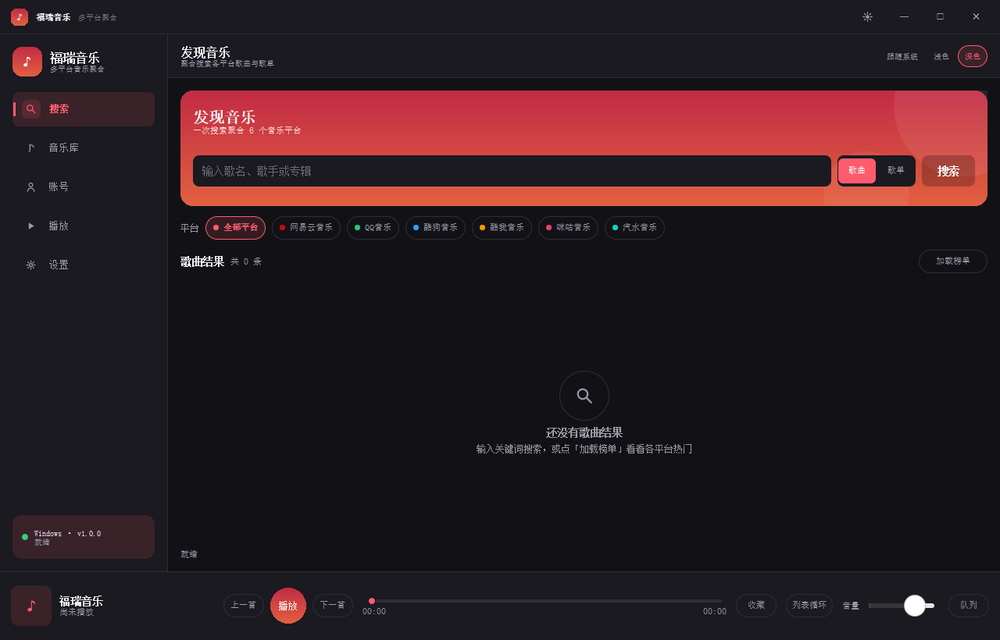
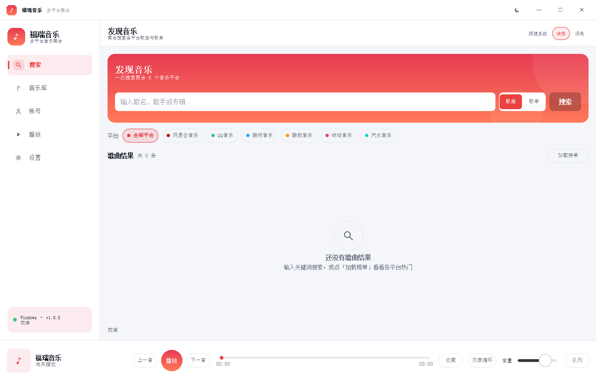
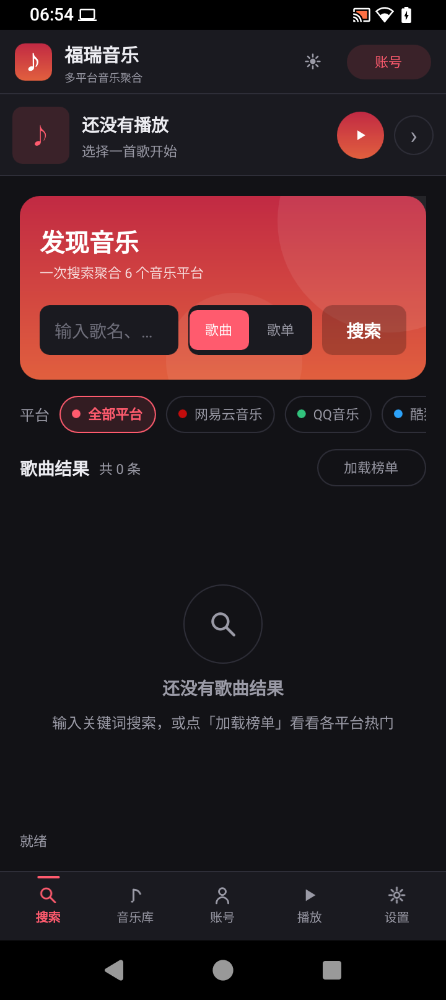

# 福瑞音乐（FuruiMusic）

一套用 Qt + QML 写的跨端音乐播放器：桌面（Windows / Linux / macOS）与移动端（Android）**共用同一套 QML 界面与 C++ 后端逻辑**，界面按窗口宽度自动在桌面宽屏外壳与移动窄屏外壳之间切换。





## 项目定位

- 界面全部是 QML（`src/ui/qml/`），窗口无边框、主题可切换，不使用 WebView 做 UI。
- 平台音源、自定义音源、在线 JS 音源都实现同一套 `MusicSource` 契约，聚合搜索与播放链路不区分来源。
- 没有官方 API 的平台不做假装支持：登录方式、账号接口状态、失败原因都会在界面上如实展示。

## 已实现能力

| 能力 | 说明 |
|---|---|
| 多平台音源聚合 | 网易云、QQ、酷狗、酷我、咪咕、汽水音乐；支持歌曲/歌单/专辑/歌手搜索、榜单、歌单详情、歌词 |
| 登录与歌单同步 | 网易云（扫码 / Cookie / 账号密码）、QQ（扫码 / Cookie）、酷狗（扫码 / Cookie）为内置直连；酷我、咪咕、汽水需配置自建账号 API 服务后登录并同步歌单 |
| 跨源替代播放 | 内置源取链失败时，自动尝试自定义音源与在线音源，并在界面标注“替代播放” |
| 自定义音源 | 可添加 HTTP 音源（自定义搜索/取链契约）与本地音乐目录 |
| 在线 JS 音源 | 支持导入洛雪（LX Music）风格的在线脚本 URL；内嵌 QuickJS 2024-01-13 执行，脚本能力、版本、检查状态、失败原因分类（syntax/runtime/timeout/network/tls/http/empty）全部可查；支持启用/禁用/更新/删除与持久化 |
| 播放器 | 播放/暂停、上一首/下一首、进度拖动、音量、顺序/列表循环/单曲循环/随机、播放队列、桌面与移动两套播放页 |
| 曲库 | 收藏、播放历史、搜索历史、下载、按平台筛选歌单/收藏/历史 |
| 主题与窗口 | 深色 / 浅色 / 跟随系统（Windows 注册表、macOS `defaults`、Linux `gsettings`，Android 回退浅色）；无边框窗口 + 自绘标题栏 + 边缘缩放 |
| 本地 OpenAPI | 可选的本地 HTTP 服务开关，便于外部控制播放 |
| 手机适配 | 窄屏布局（`MainMobile.qml`）、竖屏截图见 `docs/screenshots/` |

## 支持平台与依赖

| 平台 | 状态 | 工具链 |
|---|---|---|
| Windows 10/11 x64 | 已本机实测 | Qt 5.15.2 + MinGW 8.1（本项目主验证组合）；CMake 也支持 Qt 6（MSVC 组合未实测） |
| Linux x64 | 构建脚本已提供，**未实机验证** | Qt 5.15.2 gcc_64 或 Qt 6 + CMake |
| macOS | 构建脚本已提供，**未实机验证** | Qt 5.15.2 clang_64 或 Qt 6 + CMake |
| Android arm64-v8a | Qt5 与 Qt6 打包配置均已提供，**未实跑 APK** | Qt 5.15.2 + qmake + NDK 21.3 + JDK 11；或 Qt 6.11 + CMake + NDK 27 + JDK 17 |

通用要求：

- CMake ≥ 3.16、C++14。
- Qt 模块：Core、Gui、Network、Sql、Multimedia、Qml、Quick（Android 使用 Qt 6 时额外走 `qt_add_executable`）。
- 第三方库：QuickJS 2024-01-13 与 qrcodegen 已以源码形式内嵌在 `src/core/3rd/`，无需额外安装。
- Windows 运行 HTTPS 需要 OpenSSL 1.1 的 DLL（`libssl-1_1-x64.dll`、`libcrypto-1_1-x64.dll`）与 Qt 运行库放在可执行文件旁或 PATH 中，否则会出现 `TLS initialization failed`。

## 构建

### 桌面（CMake，推荐）

```bash
cmake -S . -B build -DCMAKE_BUILD_TYPE=Release \
      -DCMAKE_PREFIX_PATH=/path/to/Qt/5.15.2/gcc_64   # Windows 为 mingw81_64
cmake --build build --target FuruiMusic --parallel
```

- 主目标 `FuruiMusic`（单配置生成器产物如 `build/FuruiMusic`，MSVC 多配置为 `build/Release/FuruiMusic.exe`）。
- 核心逻辑在静态库 `FuruiCore` 中，桌面与 Android 共用。
- 迁移期保留的 Widgets 旧前端默认不构建，需要时加 `-DFURUI_BUILD_LEGACY_WIDGETS=ON`。
- Qt 5 的 MinGW 构建里，QuickJS 固定用 `-O1`（`-O2` 会触发 MinGW 8.1 的 SEH 汇编错误）；MSVC 下不走该编译参数。

### 桌面（qmake，可选）

`FuruiMusic.pro` 同样可构建统一 QML 前端，仓库里的 `scripts/build_windows.bat`、`build_linux.sh`、`build_macos.sh` 就是包装脚本。注意脚本里的 Qt 路径是作者本机路径（如 `E:\programes\Qt\...`），在其他机器上需要改成自己的 Qt 目录或用 `QT_DIR` 环境变量。

### Android

Qt 5（qmake，arm64-v8a）：

1. 安装 Qt 5.15.2 Android 套件、Android SDK、NDK 21.3.6528147、JDK 11。
2. 修改 `scripts/build_android.bat` 里的 SDK/NDK/JDK/Qt 路径后执行，产物在 `build/android_qt5/android-build/build/outputs/apk/debug/`。

Qt 6（CMake，arm64-v8a）：

```bash
QT_ANDROID=~/Qt/6.11.1/android_arm64_v8a \
QT_HOST=~/Qt/6.11.1/gcc_64 \
ANDROID_NDK_ROOT=~/Android/Sdk/ndk/27.1.12297006 \
JAVA_HOME=/usr/lib/jvm/java-17-openjdk-amd64 \
scripts/build_android.sh
```

Windows 主机对应 `scripts/build_android_qt6.bat`。CMake 的 Android 路径**只支持 Qt 6**，Qt 5 会直接报错提示改用 qmake。

### 运行期自检（可选）

- `FURUI_SELFTEST=<日志路径>`：无边框/主题自检，跑完自动退出。
- `FURUI_CAPTURE=<png 路径>`：启动后截图再退出。
- `FURUI_SCRIPT_TRACE=1`：打印在线音源脚本的 `lx.request` / `lx.send` / 缺失 API / Promise 拒绝，用于排查脚本。

## 使用与配置

- **数据目录**：Qt 标准路径（Windows 为 `%LOCALAPPDATA%\Furui\福瑞音乐`），数据库 `furui.db` 保存账号登录态、收藏、队列与音源配置；该文件不应提交或分享。
- **账号 API 服务**：酷我/咪咕/汽水登录与歌单同步需要先运行账号服务：

  ```bash
  python tools/account_api_server.py            # 默认监听 127.0.0.1:9764，未配置上游时只返回“未配置”说明
  python tools/account_api_server.py --demo     # 用演示数据验证链路
  ```

  契约见 `config/sources.json` 的 `userApiContract`；然后在设置页把“账号 API 服务”地址填为对应地址（支持按平台分别填写）。
- **自定义音源**：参考 `config/sources.json` 的 `customSourceContract`；示例服务 `python tools/custom_source_server.py`。
- **在线 JS 音源**：设置页 → 在线音源 → 粘贴 `.js` 的 HTTPS 直链导入；导入只代表“保存并执行成功”，是否真的能取链要看“检查”结果。脚本执行过程中拿不到账号 Cookie，宿主只提供 `lx.request`/`lx.utils` 等能力。
- **网易云 Cookie 登录**：登录页选择网易云 → Cookie 方式，按页面指引从浏览器开发者工具复制 `MUSIC_U` 等 Cookie；扫码方式受网易云风控（8821）影响，不保证可用。

## 已知限制

- **内置平台接口是示例模板**：`config/sources.json` 里的搜索/取链端点可按需替换；部分平台的取链依赖登录态或已失效，失败时界面会给出如实原因，而不是静默跳过。
- **在线音源现状**：详见下节「在线音源实测（2026-11-09）」；本次 5 个公开源都只声明 `musicUrl`、没有 `search`，所以不会贡献搜索结果。
- **扫码登录**：网易云扫码受服务端风控（8821），推荐 Cookie 路径；其他平台扫码可用性取决于平台策略。
- **宿主能力边界**：在线脚本运行时的 `crypto.aesEncrypt`、`crypto.rsaEncrypt`、`utils.zlib` 为显式桩（本次 5 个公开源未使用），用到时会明确报“宿主未实现该能力”。
- **未实机验证**：Linux、macOS、Android 仅有构建配置/脚本；Windows 为唯一完整实机验证的桌面平台。
- **旧 Widgets 前端**：`src/desktop/` 为迁移期保留，默认不编译、不再新增功能。
- 仓库不包含 `bin/`（运行库、OpenSSL DLL、APK）与 `reference/`（本地研究用的洛雪源码副本），所以 `docs/multi-platform-music-research.md` 中指向 `reference/...` 的路径在远端不可访问。

## 在线音源实测（2026-11-09）

测试曲目为《晴天》：`wy 186016`、`tx 0039MnYb0qxYhV`、`kg b3a52a7a958bf0aed0ebfba2e9a818b7`、`kw 228908`、`mg 60054701923`。五个脚本均能下载（HTTP 200），初始化与取链结果如下：

| 源 | 初始化 | 声明能力 | 实际取链结果 |
|---|---|---|---|
| LX 官方源 | 成功 | `kg/kw/mg/tx/wy/local`，仅 `musicUrl`，128k/320k/flac/flac24bit | tx、kg、kw 返回 206 `audio/mpeg` 可播地址；wy 上游 502；mg 返回 `get music url failed` |
| Huibq | 成功 | `kg/kw/mg/tx/wy`，仅 `musicUrl`，128k/320k | tx、kw 可用（tx 与 LX 返回同一音频文件）；wy/kg/mg 返回固定的 `panspace.kuwo.cn` 兜底地址——HTTP 可播但不一定是对应歌曲（wy 186016 的响应还附带“无法获取播放链接”） |
| JuheApi（新增） | 成功 | `kg/kw/mg/tx/wy`，仅 `musicUrl` | tx、kw 取链成功并实测可播；wy/kg 返回 `get url failed`；mg 返回空地址 |
| Flower | 成功 | `kg/kw/mg/tx/wy`，仅 `musicUrl`，128k | 取链请求 `http://97.64.37.235/flower/v1/...` 全部 404（上游服务已挂） |
| 六音 | 失败（runtime） | 未声明 | 脚本自检后抛出“加载音源脚本失败，请前往 www.sixyin.com 下载最新版本”，未发出任何网络请求，判断为作者端停用/防盗版自检 |

- 五个脚本都不声明 `search`，因此不会贡献搜索结果。
- 本次未发现宿主缺少某个 `lx.*` 能力（已开启能力追踪，无缺失记录）；初始化失败属于脚本自身行为，不是宿主兼容性问题。

### 借鉴 AlgerMusicPlayer 的接入设计

参考 [AlgerMusicPlayer](https://github.com/algerkong/AlgerMusicPlayer)（MIT）的 `services/musicSource` 子系统，只提炼设计、不复制代码：

1. **统一 provider 注册表**：内置源（含 UnblockNeteaseMusic）、自定义 API、JS 插件都实现同一套 `MusicSourceProvider` 契约，解析器不区分类型，按启用状态与优先级串联。
2. **解析链路预算与失败缓存**：单源 stage 预算 15s、整条链 30s，超时/错误/跳过都记入 attempts；失败源写短暂失败缓存，避免每次播放都等一遍死链。
3. **返回值校验后才缓存**：解析出的地址先做 `Range: bytes=0-8191` 探测（要求 206 或音频类型，支持 JSON 里嵌 URL），通过才写入成功缓存。注意：纯可播性校验识别不了 Huibq 这种“可播但不是目标歌曲”的兜底地址。
4. **插件隔离与安装前探测**：每个插件独立 Worker realm，初始化有超时、每次调用 20s 超时、插件 HTTP 走主进程桥绕开 CORS；崩溃即终止并重建；安装前先沙箱运行一次，坏脚本拒绝入库；运行实例按脚本指纹缓存，脚本更新自动失效。
5. **媒体代理**：用 Electron 自定义协议把需要 Referer/Cookie 的直链包装给主进程转发。对应本工程的现实问题：Qt 6 的 `QMediaPlayer::setSource` 无法携带自定义请求头（Qt 5 分支已用 `QMediaContent(QNetworkRequest)` 解决）。

## 目录结构

```
.
├── CMakeLists.txt              # 主构建（FuruiCore / FuruiMusic）
├── FuruiMusic.pro              # qmake 构建（桌面与 Qt5 Android）
├── config/sources.json         # 平台音源配置与契约（搜索/取链/登录/账号 API）
├── src/
│   ├── core/                   # C++ 后端：音源、聚合、账号、播放、曲库、在线音源宿主
│   │   └── 3rd/                # QuickJS、qrcodegen（源码内嵌）
│   ├── ui/                     # QML 前端、主题、平台适配、main.cpp
│   └── desktop/                # 迁移期 Widgets 旧前端（默认不构建）
├── android/  android_qt6/      # Android 打包资源（manifest、res）
├── docs/                       # 架构/迁移/研究文档与截图
├── scripts/                    # 各平台构建脚本
├── tools/                      # 账号 API / 自定义音源示例服务
└── .github/workflows/          # Release 工作流（见下）
```

## CI / Release 工作流

`.github/workflows/release.yml` 已按本工程实际情况重写，触发条件为推送 `v*` tag 或手动 `workflow_dispatch`，只使用内置 `GITHUB_TOKEN`（`permissions: contents: write`），不需要额外 secrets。

| Job | Runner / 工具链 | 产物 |
|---|---|---|
| Windows (MinGW 8.1 x64) | `windows-2022`，Qt 5.15.2 `win64_mingw81` + MinGW 8.1 + Ninja | `FuruiMusic-windows-x64.zip`（含 windeployqt 运行库与 QML 模块；**不含 OpenSSL**，包内附 `OPENSSL-REQUIRED.txt` 说明） |
| Linux (x86_64) | `ubuntu-22.04`，Qt 5.15.2 `gcc_64` | `FuruiMusic-linux-x86_64.AppImage` |
| macOS (x86_64) | `macos-15-intel`，Qt 6.8.3 `clang_64` | `FuruiMusic-macos-x86_64.zip`（`FuruiMusic.app`，bundle id `cn.furui.music`） |

- 构建命令与上面的「构建」一节一致。Windows job 实际执行的是
  `cmake -S . -B build -G Ninja -DCMAKE_BUILD_TYPE=Release -DCMAKE_PREFIX_PATH="$QT_ROOT_DIR" -DCMAKE_C_COMPILER=gcc -DCMAKE_CXX_COMPILER=g++`，
  再 `cmake --build build --parallel`；Linux、macOS 只是把 `-G Ninja` 与编译器指定去掉（runner 默认生成器即可）。
- 未纳入 Release：Windows XP（Qt 5.7 加载不了 QML 2.15）、MSVC 组合（本工程未验证）、Inno Setup 安装包（仓库没有 `installer/` 脚本）、Android（打包配置存在但未实跑 APK）。
- 验证状态：Windows 的构建/部署命令已在本机同版本工具链上跑通；Linux、macOS 两个 job 属按配置推断，需要实际推一次 tag 才能确认。
- 工作流不会把构建日志推送到分支；失败时请查看 Actions 日志。

## 许可证

本项目以 MIT 协议发布，见 [LICENSE](LICENSE)。内嵌的第三方源码：

- QuickJS（`src/core/3rd/quickjs/`）：MIT，见其目录内 LICENSE。
- qrcodegen（`src/core/3rd/qrcodegen.*`）：MIT。

Copyright (c) 2026 spygg
